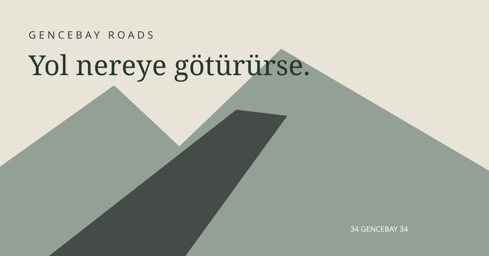

# GENCEBAY ROADS

**Yol nereye götürürse.** Bir bitiş çizgisi yok. Sadece sen, araban ve önündeki yol.

Tarayıcıda çalışan, özgün prosedürel 3D manzaralar arasında sonsuz sürüş oyunu. BİLP1117 Web Programlama I dönem projesi için HTML, CSS ve anlaşılabilir JavaScript modülleriyle geliştirildi. Backend, hesap, API anahtarı veya internet bağlantısı gerektirmez.

**Kaynak kod:** [emengin/gencebay-roads](https://github.com/emengin/gencebay-roads) · **Canlı adres:** [roads.emengin.dev](https://roads.emengin.dev/)

Yayın GitHub Actions → GitHub Pages üzerinden yapılır. `main` dalına gönderilen her değişiklik otomatik derlenir, test edilir ve yayınlanır. Alan adı için Cloudflare'da `roads` CNAME kaydı `emengin.github.io` hedefine, DNS only (proxy kapalı) olarak yönlendirilmelidir. İlk DNS ve HTTPS sertifikası kurulumu tamamlanana kadar özel alan adı açılmayabilir.

`.github/workflows/https.yml`, başarılı yayından sonra GitHub'ın alan adı sertifikasını bekler; onay geldiğinde HTTPS zorunluluğunu açar ve gerçek adresten oyunun HTML'ini kontrol eder. İlk DNS yayılımı uzun sürerse **Actions → Enable and verify HTTPS → Run workflow** ile tekrar çalıştırılabilir. `.dev` adresinin tarayıcıda açılabilmesi için geçerli HTTPS sertifikası gerekir.



## Hemen oyna — internet gerekmez

1. ZIP dosyasının **tamamını** bir klasöre çıkarın.
2. Windows'ta **`BASLAT.cmd`** dosyasını çift tıklayın. Node/npm/Python kurulumu gerekmez.
3. Oyun `http://127.0.0.1:4173` adresinde açılır. Açılmazsa adresi tarayıcıya yazın.
4. Aracınızı ve rengini seçip **YOLCULUĞA BAŞLA** düğmesine basın. W gaz, F otomatik sürüş.
5. Sunucuyu durdurmak için başlatıcının penceresini kapatın.

Linux/macOS: Python 3 veya Node.js kuruluysa `sh baslat.sh`. Tarayıcıda aynı adresi açın. Python/Node kurulumu sunum gününden önce yapılmalıdır; sunucu çalışırken internet kullanmaz.

`index.html` dosyasını `file://` ile doğrudan açmayın. ES modülleri için localhost sunucusu gerekir. Tüm oyun dosyaları `dist/` içinde hazırdır; **oynamak için npm install veya npm build çalıştırılmaz.**

## Özellikler

- Gerçek Three.js/WebGL 2 sahnesi ve dünya koordinatlarında hareket eden araç.
- Classic Sedan, Sport Coupe, Off-Road 4×4, Pickup Truck ve Retro Classic. Ayrı gövde profilleri, farklı boyutlar, camlar, iç mekân, jantlar, lambalar, açık pickup kasası, SUV aksesuarları.
- Her aracın arka tamponuna bağlı, `34 GENCEBAY 34` yazılı CanvasTexture plaka. Gece emissive plaka ve yerel aydınlatma.
- Seed ile deterministik Catmull–Rom yol, noise tabanlı arazi, vadiler, göl havzaları ve orman kümeleri.
- 160 metrelik yol çevresi parça sistemi; uzak arazi sürüşünde oyuncuyu izleyen ek terrain penceresi. Gerideki parçaların GPU kaynakları dispose edilir. InstancedMesh ağaç, çim, kaya ve yol kenarı dikmeleri. Floating origin.
- Asfalt, dağ ve toprak yolu; manuel yol dışı sürüş ve farklı tutuş.
- 90 Hz sabit adımlı arcade fizik; gaz, fren/geri, el freni, yokuş etkisi, kütleye bağlı direksiyon tepkisi ve görsel süspansiyon.
- Dört kamera: takip, yakın takip, kokpit, sinematik. Fareyle yörünge ve tekerlekle yakınlaşma.
- Pure pursuit otomatik sürüş; viraja göre hedef hızını azaltır. Manuel kontrol otomatiği devralır.
- Dört manzara, dört gün saati ve beş hava seçeneği. Yağmur/kar parçacıkları, gece yıldızları, gerçek SpotLight farlar.
- Low/Medium/High/Ultra: çözünürlük, çizim mesafesi, bitki yoğunluğu, gölgeler ve parçacık sayısını değiştirir.
- 3D garaj, renk seçimi, fotoğraf modu ve arayüzsüz PNG indirme.
- Yerel yolculuk günlüğü: toplam/en uzun mesafe, sefer sayısı, son araç, manzara ve seed.
- Web Audio motor, lastik/rüzgâr, yağmur, fren ve kuş sesi sentezi. Ses kullanıcı etkileşimiyle başlar.
- Türkçe arayüz; klavye, fare ve standart gamepad eksen/tetik desteği.

## Kontroller

| Girdi | İşlev |
| --- | --- |
| W / ↑ | Gaz |
| S / ↓ | Fren; durduktan sonra basılı tutunca geri vites |
| A D / ← → | Direksiyon |
| Space | El freni |
| Shift | Geçici yüksek hız sınırı |
| C | Kamera |
| Fare sürükleme | Garaj/fotoğraf yörüngesi; sürüşte etrafa bakma |
| Fare tekerleği | Takip/garaj/fotoğraf yakınlığı |
| F | Yolu izleyen otomatik sürüş |
| R | Mevcut güzergâhta yola dön |
| H | Farlar |
| P / Escape | Mola/ayarlar; fotoğraftan çıkış |
| M | Ses |
| U | Sürüş arayüzünü gizle/göster |
| Gamepad sol çubuk / RT / LT / A | Direksiyon / gaz / fren / el freni |

Fareyle Ayarlar → dünya kodunu değiştir → ↻: aynı seed ile aynı dünyayı yeniden oluşturur. Yol türü de güzergâh parametresidir. Manzara, hava ve grafik seçenekleri gerçek sahneyi etkiler. Sekme odağı kaybolursa sürüş durur; ayarları kapatınca devam eder.

## Geliştirme

Node.js 22 önerilir (Vite 6 için Node 18/20/22 desteği vardır).

```sh
npm ci
npm run dev
npm test
npm run build
npm start
```

`npm run dev` Vite geliştirme sunucusunu; `npm start` yalnızca hazır `dist` dosyalarını 4173 portunda sunar. Windows PowerShell alternatifi: `powershell -File scripts/serve.ps1 -Port 4174`. Geliştirme bağımlılıklarının ilk kurulumu internet ister; derlenmiş oyun istemez. Bu çalışma ortamında Node PATH'te olmadığı için proje içi `.tools` kullanılmıştır; `.tools` dağıtımın parçası değildir.

## Mimari

| Dosya / klasör | Sorumluluk |
| --- | --- |
| `index.html`, `src/style.css`, `src/ui.css` | Erişilebilir arayüz ve görünüm |
| `src/game.js` | Sahne, 90 Hz fizik döngüsü, parçalar, floating origin, oyun durumları |
| `src/world/route.js` | Seed, spline güzergâh, yol–zemin eşlemesi, yükseklik ve göl havzaları |
| `src/world/world.js` | Gerçek mesh parçaları, instancing, yol çizgileri ve kaynak temizliği |
| `src/vehicles/catalog.js` | Beş aracın boyut ve fizik parametreleri |
| `src/vehicles/factory.js` | Loft gövdeler, ayrıntılar, tekerlekler, iç mekân, plaka ve farlar |
| `src/vehicles/physics.js` | Hız, tutuş, bisiklet modeli ve pure pursuit |
| `src/render/` | Kamera, gökyüzü shader'ı, sis, ışık ve yağış |
| `src/core/` | Girdi, deterministik matematik, ayarlar ve günlük |
| `src/audio/`, `src/ui/` | Sentezlenen ses ve DOM etkileşimleri |
| `tests/` | Fizik, deterministik dünya, plaka/geometri, kaynak ömrü testleri |
| `scripts/` | Çevrimdışı sunucular ve teslim paketi |

Detaylı açıklamalar: [SUNUM_REHBERI.md](SUNUM_REHBERI.md) · [Referans ve teknik kararlar](docs/REFERANS_ANALIZI.md) · [Test raporu](docs/TEST_RAPORU.md).

## Alan adına ve GitHub Pages'e yükleme

`npm run build` sonrasında `dist/` klasörünün **içindekileri** statik hosting'in web köküne veya bir alt klasöre yükleyin. Vite `base: './'` kullanır; alt klasöre dağıtımı destekler. Sunucu tarafı yönlendirme, veritabanı veya Node hizmeti gerekmez. HTTPS önerilir. Cache nedeniyle güncelleme görünmezse tarayıcı önbelleğini yenileyin. `dist` içindeki hash'li JS ve CSS dosyalarını index ile birlikte taşıyın.

GitHub deposu [emengin/gencebay-roads](https://github.com/emengin/gencebay-roads) olarak oluşturuldu; Pages kaynağı **GitHub Actions** olarak ayarlandı. `.gitignore` bağımlılıkları ve yerel araçları hariç tutar. Kaynak, lisans, kilit dosyası ve `dist` repoda bulunur. `.github/workflows/pages.yml`, `main` dalında build + test + teslim ZIP'i + Pages yayını yapar. Her yayının durumunu reponun **Actions** bölümünden görebilirsiniz. Alternatif hosting kullanırken dist içeriğini doğrudan web köküne koyabilirsiniz. `roads.emengin.dev` alan adı GitHub Pages ayarında tanımlıdır; DNS yönlendirmesi ve HTTPS durumu ayrıca kontrol edilmelidir.

Teslim ZIP'i oluşturma: önce `npm run build`, ardından `npm run package`. İşlem build'deki lisans bildirimlerini de pakete kopyalar. Çıktı `release/GENCEBAY-ROADS-teslim.zip`.

## Doğrulama ve sınırlar

Otomatik testler: beş aracın üç rota türünde beşer dakikalık pure pursuit sürüşü, yağmur/kar tutuşu, hızlanma–fren–geri, 30/144 FPS fizik eşdeğerliği, 20 km boyunca sabit parça sayısı, parça sınırlarının eşleşmesi, seed ve beş plakanın tam metni/3D yönü.

**Gerçek tarayıcı görsel QA tamamlanamadı:** mevcut bilgisayar kullanım aracı URL'yi güvenle belirleyemediği için durdu. GPU shader çıktısı, gerçek FPS, plakanın ekranda okunabilirliği, PNG indirimi, sesin duyulması ve tüm düğmelerin elle denenmesi henüz doğrulanmış sayılmaz. Teslim öncesi [manuel kontrol listesi](docs/TEST_RAPORU.md) uygulanmalıdır. Slow Roads ile eşdeğer görsel kalite iddiası doğrulanmış değildir.

Fizik rahatlatıcı arcade modelidir; gerçekçi çarpışma, hasar, trafik veya devrilme sistemi yoktur. Direksiyon/fren destekli gamepad uygulandı fakat gerçek cihazla denenmedi. Mobil dokunmatik sürüş ve İngilizce çeviri eklenmedi. Sistem masaüstü klavye/fare deneyimini hedefler. Model ve sesler özgün prosedürel üretimlerdir; fotogerçekçi GLB varlıkları kullanılmadı.

## Lisans ve ilham

MIT — [LICENSE](LICENSE). Bağımlılık bildirimleri: [THIRD_PARTY_NOTICES.md](THIRD_PARTY_NOTICES.md).

[Slow Roads](https://slowroads.io/) ve [geliştiricinin resmi Web Edition sayfası](https://topographinteractive.itch.io/slow-roads), rahatlatıcı sonsuz sürüş türüne referans olmuştur. Kod ve içerik kopyalanmamıştır. Bu proje Codex yardımıyla geliştirilmiştir; ayrıntılar sunum rehberindedir.

Üniversite teslim tarihi: **28 Kasım 2026**. Build ve otomatik test raporu geliştirme oturumunda hazırlanmıştır; son kullanıcı cihazında manuel doğrulama için zaman ayrılmalıdır.
