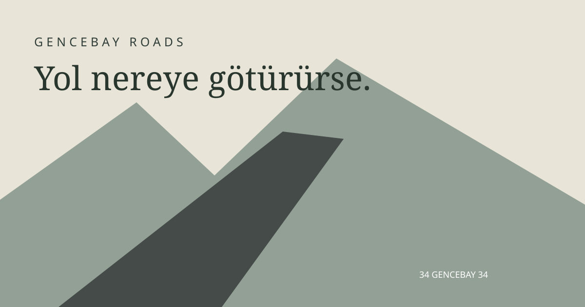

# GENCEBAY ROADS

Aracınızı seçin ve sürekli üretilen üç boyutlu manzaralar arasında kendi temponuzda yolculuk yapın. Yarış, süre sınırı veya bitiş çizgisi olmadan; virajlar, değişen hava ve farklı gün saatleriyle sakin bir sürüş deneyimi.

**[Hemen oynayın → roads.emengin.dev](https://roads.emengin.dev/)**

Oyun masaüstü tarayıcılar için tasarlanmıştır. Hesap, ücretli API veya ek oyun kurulumu gerekmez. İndirilen sürüm yerel olarak çevrimdışı çalışabilir.



## Oyun özellikleri

- **Beş araç:** Classic Sedan, Sport Coupe, Off-Road 4×4, Pickup Truck ve Retro Classic. Farklı boyutlar, gövde tasarımları ve sürüş parametreleri.
- **Sonsuz yolculuk:** Dünya koduna göre oluşturulan yollar, arazi, vadiler ve bitki örtüsü. Aynı kod ve rota türü aynı güzergâhı üretir.
- **Farklı ortamlar:** Dört manzara, asfalt/dağ/toprak yolları, dört gün saati ve beş hava seçeneği.
- **Manuel veya otomatik sürüş:** Direksiyonu kontrol edin ya da yolu takip eden otomatik sürüşü açın. Manuel direksiyon girdisi kontrolü devralır.
- **Dört kamera:** Takip, yakın takip, kokpit ve sinematik görünüm.
- **Garaj ve fotoğraf:** Araç/rengini seçme, serbest fotoğraf kamerası ve arayüzsüz PNG indirme.
- **Atmosfer:** Yağmur ve kar parçacıkları, gece yıldızları, araç farları ve sürüşe tepki veren sesler.
- **Yerel yolculuk günlüğü:** Toplam mesafe, en uzun yolculuk, sefer sayısı ve son seçimler bu tarayıcıda saklanır.
- **Ayarlanabilir grafikler:** Düşük, Orta, Yüksek ve Ultra kalite; çözünürlük, görüş mesafesi, bitki örtüsü, gölgeler ve parçacık yoğunluğu ayarlanır.

## Kontroller

Garajdan araç ve renk seçip **YOLCULUĞA BAŞLA** düğmesine basın.

| Kontrol                         | İşlev                                             |
| ------------------------------- | ------------------------------------------------- |
| W / ↑                           | Gaz                                               |
| S / ↓                           | Fren; durduktan sonra basılı tutulursa geri vites |
| A D / ← →                       | Direksiyon                                        |
| Boşluk                          | El freni                                          |
| Shift                           | Geçici yüksek hız sınırı                          |
| C                               | Kamera değiştir                                   |
| F                               | Otomatik sürüşü aç / kapat                        |
| R                               | Mevcut güzergâhta yola dön                        |
| H                               | Farlar                                            |
| P / Esc                         | Mola / ayarlar; fotoğraf modundan çıkış           |
| M                               | Sesi aç / kapat                                   |
| U                               | Sürüş arayüzünü gizle / göster                    |
| Fareyle sürükleme / tekerlek    | Çevreye bakış, yörünge ve yakınlaştırma           |
| Gamepad sol çubuk / RT / LT / A | Direksiyon / gaz / fren / el freni                |

Gamepad desteği tarayıcıya ve cihaz eşlemesine bağlıdır. Sekme odağı kaybolduğunda sürüş duraklar. Ses, ilk kullanıcı etkileşiminden sonra başlar.

## Kullanılan teknolojiler

| Teknoloji                                       | Kullanım                                                          |
| ----------------------------------------------- | ----------------------------------------------------------------- |
| HTML5, CSS ve JavaScript ES modülleri           | Türkçe arayüz, oyun akışı ve modüler kaynak kodu                  |
| Three.js 0.180.0 ve WebGL 2                     | Üç boyutlu dünya, araç geometrileri, ışık, gölge ve parçacıklar   |
| Catmull–Rom eğrileri ve deterministik noise     | Tekrarlanabilir yol güzergâhları ve prosedürel arazi              |
| 90 Hz sabit adımlı arcade fizik                 | Gaz, fren, geri vites, tutuş ve direksiyon tepkisi                |
| InstancedMesh, parça sistemi ve floating origin | Tekrarlanan çevre nesneleri ve uzun yolculuklarda kaynak yönetimi |
| Pure pursuit                                    | Virajlara göre hızını ayarlayan otomatik yol takibi               |
| Web Audio API                                   | Motor, lastik, rüzgâr, yağmur ve kuş seslerinin sentezi           |
| localStorage ve Canvas                          | Yerel ayarlar/günlük ve fotoğraf çıktısı                          |
| Vite 6.4.6 ve Node.js                           | Geliştirme, üretim derlemesi ve otomatik testler                  |
| GitHub Actions ve GitHub Pages                  | Test edilen statik oyunun HTTPS üzerinden yayınlanması            |

Üretim oyunu uzak model, font, müzik, analiz hizmeti veya API anahtarı kullanmaz. Araçlar ve çevre kodla oluşturulur; çalışma sırasında harici yapay zekâ servisine bağlanılmaz.

## Bilgisayarda çevrimdışı oynama

Depodaki **Code → Download ZIP** seçeneğiyle dosyaları indirin ve arşivin tamamını çıkarın.

- **Windows:** `BASLAT.cmd` dosyasını açın. Hazır `dist` sürümü yalnızca bu bilgisayarda, `http://127.0.0.1:4173` adresinde sunulur. Node.js veya Python kurulumu gerekmez.
- **Linux/macOS:** Python 3 veya Node.js kuruluysa `sh baslat.sh` komutunu çalıştırın.
- Sunucuyu durdurmak için terminal penceresini kapatın veya Ctrl+C kullanın.

`index.html` dosyasını doğrudan çift tıklamak yerine başlatıcıyı kullanın; ES modülleri HTTP sunucusu gerektirir. Oynamak için npm kurulumu veya yeniden derleme gerekmez.

## Geliştirme

Node.js 24 LTS önerilir:

```sh
npm ci
npm run dev
```

Üretim sürümü ve doğrulama:

```sh
npm run build
npm test
npm audit
npm start
```

`npm start` hazır `dist/` klasörünü yerel olarak sunar. `npm run package` kaynak ve derlemeyi `release/GENCEBAY-ROADS-teslim.zip` arşivine toplar.

Kaynak kodunda `src/world` yol/çevreyi, `src/vehicles` modelleri ve fiziği, `src/render` kamerayı/atmosferi, `src/ui` arayüzü, `src/audio` sesi yönetir. `tests` otomatik doğrulamaları içerir. [Teknik işleyiş](SUNUM_REHBERI.md) ve [test kapsamı](docs/TEST_RAPORU.md) ayrıca belgelenmiştir.

## Yayınlama

`npm run build` sonrasında `dist/` içeriği statik bir sunucuda yayınlanabilir. Göreli asset adresleri (`base: './'`) kök veya alt klasörde çalışır. Node.js hizmeti, veritabanı veya sunucu taraflı yönlendirme gerekmez.

Bu depoda `main` güncellemeleri GitHub Actions ile derlenip test edilir ve GitHub Pages'e yayınlanır. Özel alan adı ve HTTPS ayarları deponun **Settings → Pages** bölümünden yönetilir. Kaynak değiştirildiğinde hash'li JS/CSS dosyaları HTML ile birlikte yayınlanmalıdır.

## Gizlilik, güvenlik ve desteklenen deneyim

Oyun oyuncu hesabı açmaz; ayarları ve yolculuk günlüğünü bir sunucuya göndermez. Kayıtlar bu tarayıcıda tutulur ve site verileri temizlenerek silinebilir. Siteye bağlanırken barındırma hizmeti standart bağlantı bilgilerini işleyebilir. Güvenlik bildirimi için [SECURITY.md](SECURITY.md) dosyasına bakın.

Güncel, WebGL 2 destekleyen bir masaüstü tarayıcı ve donanım hızlandırma önerilir. Mobil dokunmatik sürüş, trafik, araç hasarı ve gerçekçi çarpışma simülasyonu bulunmaz. Fizik arcade türündedir; performans cihaz ve grafik ayarlarına göre değişir.

## Lisans

MIT — [LICENSE](LICENSE). Bağımlılık lisansları [THIRD_PARTY_NOTICES.md](THIRD_PARTY_NOTICES.md) içinde listelenmiştir. Rahatlatıcı sonsuz sürüş türü için [Slow Roads](https://slowroads.io/) ilham kaynağıdır; kaynak kodu veya içerikleri bu projeye kopyalanmamıştır.
